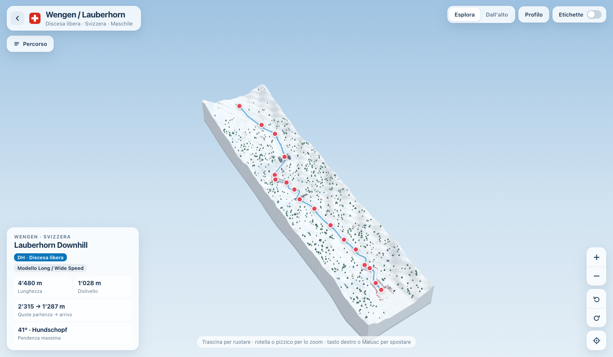
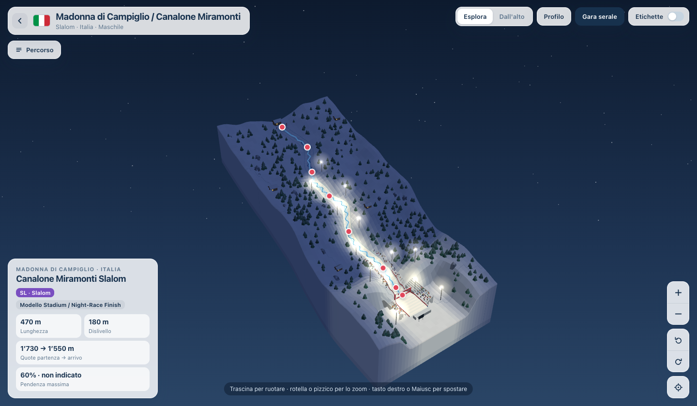

# 3DSkiTracks

**3DSkiTracks è il componente di LiveSportArena dedicato alle piste della Coppa del Mondo di sci alpino.** Raccoglie 68 diorami interattivi per 38 piste di discesa libera, super-G, gigante e slalom: tutte le gare della stagione 2026/27. Puoi seguire una gara curva per curva, individuare un salto di cui hai sentito parlare in telecronaca o guardare dall’alto il tratto che precede l’arrivo.



*Wengen, Svizzera · Discesa libera maschile sul Lauberhorn.*

## Lungo il Lauberhorn

A Wengen la discesa misura **4.480 metri**, con **1.028 metri di dislivello**. Per ritrovare l’Hundschopf lungo quei quattro chilometri, apri **Percorso** e seleziona il salto. La scheda racconta il passaggio e la mappa ne mostra la posizione lungo la discesa. Con le frecce della tastiera puoi seguire i punti successivi fino al traguardo.

La vista **Dall’alto** aiuta a leggere la successione delle curve. Il **Profilo** mostra come cambia la pendenza lungo il diorama. Per esplorare il terreno da vicino, trascina la mappa per ruotarla e usa la rotella o il gesto a pizzico per avvicinarti.

## Sotto le luci di Campiglio

Sul Canalone Miramonti la scala cambia. Lo slalom di Madonna di Campiglio concentra **180 metri di dislivello in 470 metri di pista**. La mappa si apre in notturna, con i riflettori che disegnano nel bosco la linea verso le tribune. Il selettore **Giorno/Notte** permette di passare alla luce del giorno.



*Madonna di Campiglio, Italia · Slalom maschile sul Canalone Miramonti.*

## Esplorare l’atlante

Dalla pagina iniziale puoi scegliere una località oppure filtrare per specialità. Per visitare l’atlante offline, scarica il progetto e apri `index.html` nel browser.

I diorami si basano su sei archetipi di terreno. Le geometrie sono illustrative (non rilievi GPS). I criteri di ricostruzione e le fonti dei dati sono raccolti in [Limiti e fonti](docs/LIMITI_E_FONTI.md).

<details>
<summary><strong>Aggiornare le mappe e pubblicare su GitHub Pages</strong></summary>

Le schede delle piste si trovano in `data/research/`. Le configurazioni dei diorami sono in `data/course-configs.json` e l’interfaccia condivisa in `src/`. Dopo una modifica, rigenera le pagine dalla radice del progetto con Python 3.8 o successivo.

```sh
python3 build.py
```

Includi nel commit anche `index.html` e le pagine generate in `maps/`. Per la prima pubblicazione, apri **Settings → Pages**, scegli **Deploy from a branch**, seleziona il ramo che contiene il sito e la cartella **/(root)**, quindi premi **Save**. Mantieni `.nojekyll` alla radice. GitHub mostrerà l’indirizzo pubblico nella stessa schermata.

</details>
